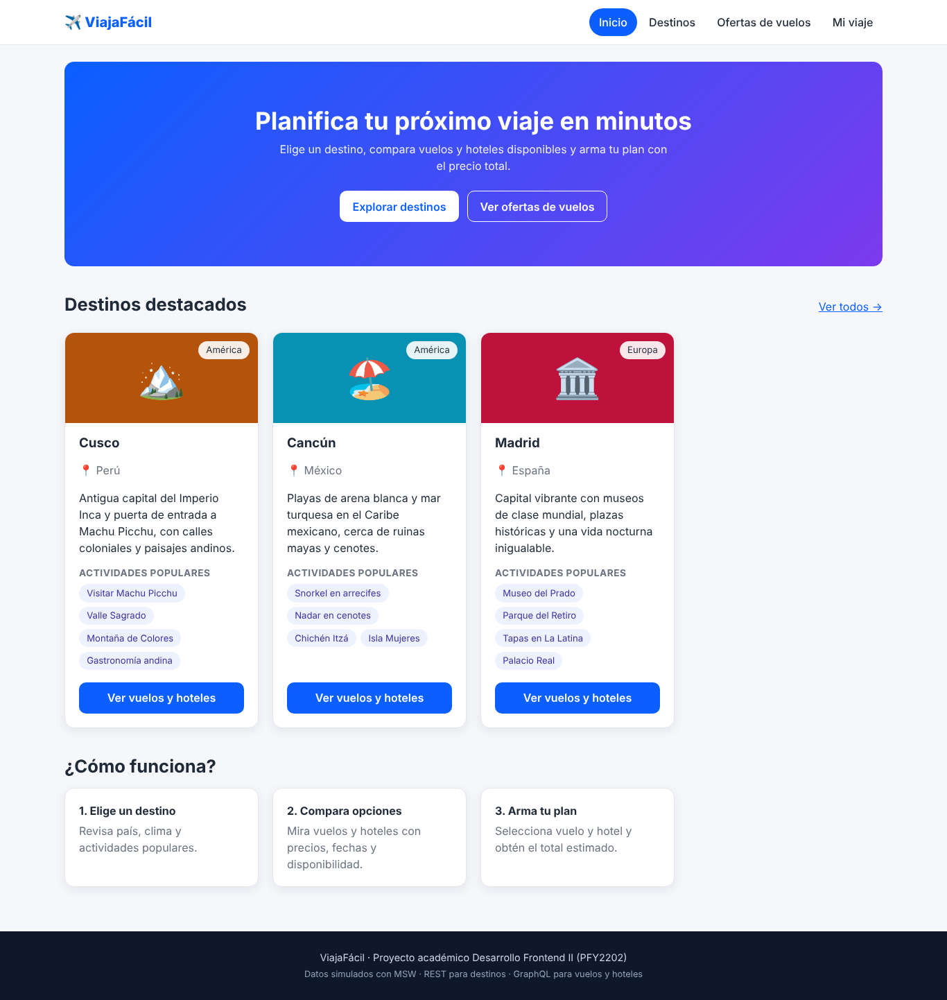
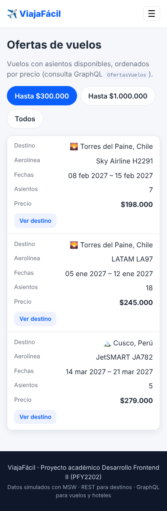
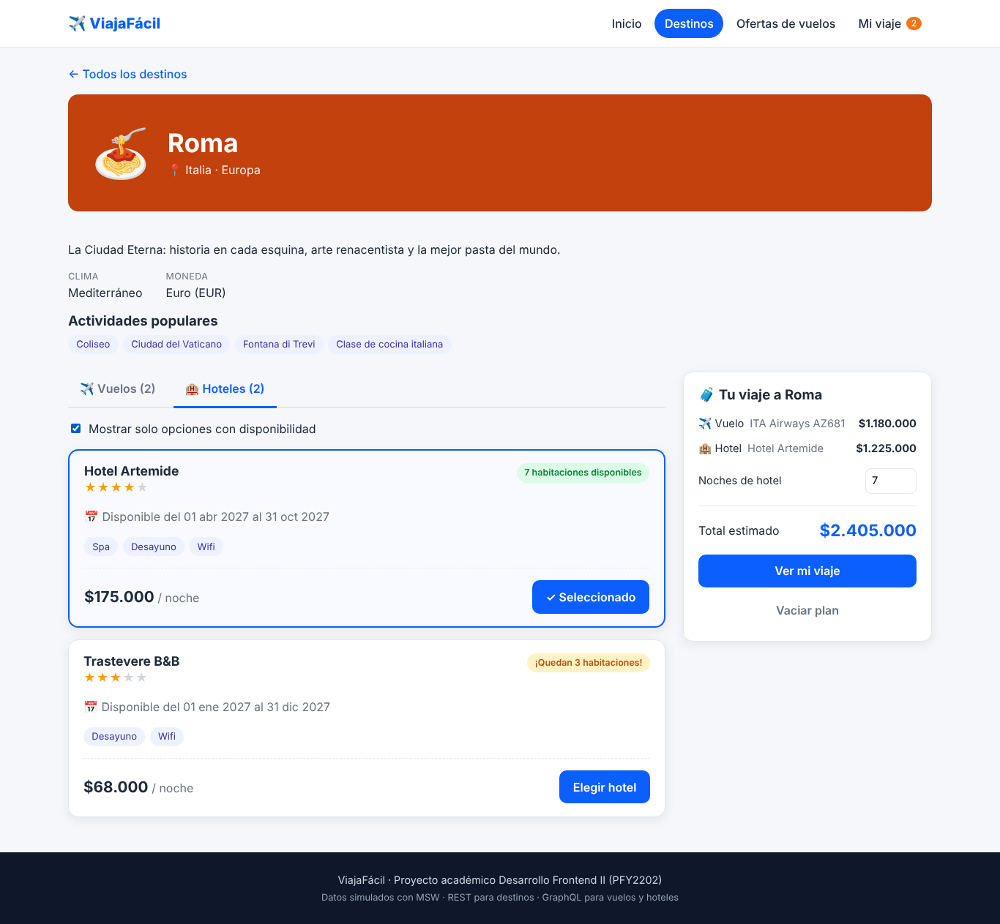

# ✈️ ViajaFácil – Agencia de viajes

Aplicación web para una agencia de viajes donde los usuarios pueden explorar destinos, comparar **vuelos** y **hoteles** disponibles y armar su plan de viaje con el precio total estimado.

Proyecto de la **Semana 5 – Desarrollo Frontend II (PFY2202)**: *Integrando nuestro frontend con backend*.

🔗 **Demo (GitHub Pages):** https://camiluck.github.io/viajes-camila-luck-pfy2202/

---

## 🧰 Tecnologías

| Tecnología | Uso |
|---|---|
| React 19 + Vite | Interfaz y empaquetado |
| HTML, CSS, JavaScript | Estructura, estilos responsivos (Flexbox / Grid / media queries) |
| React Router DOM | Navegación entre vistas (`HashRouter`) |
| MSW (Mock Service Worker) | Backend mock: intercepta las peticiones REST y GraphQL en el navegador |
| Fetch API | Consumo de la API **REST** mock |
| Apollo Client + GraphQL | Consumo de la API **GraphQL** mock |
| gh-pages | Publicación en GitHub Pages |

## ✅ Funcionalidades

- **Listado de destinos (REST):** país, continente, clima, moneda, descripción y actividades populares.
- **Filtros:** por continente (se envía como query param a la API REST) y búsqueda por nombre, país o actividad.
- **Detalle de destino:** al seleccionar un destino se consultan sus **vuelos y hoteles vía GraphQL** con precio, fechas y disponibilidad.
- **Filtro "solo disponibles":** cambia una variable de la query GraphQL (`soloDisponibles`).
- **Planificador de viaje:** el usuario elige un vuelo y un hotel, ajusta las noches y ve el total estimado. El plan se guarda en `localStorage`.
- **Ofertas de vuelos (GraphQL):** vuelos de todos los destinos ordenados por precio, con filtro por precio máximo.
- **Estados de carga y error** en cada consulta (spinner, mensaje y botón *Reintentar*).
- **Página 404** para rutas inexistentes y mensaje para destinos que no existen.
- **Diseño responsivo:** menú hamburguesa en móvil, grillas adaptativas y tabla que se transforma en tarjetas.

## 🗺️ Rutas (React Router)

| Ruta | Vista |
|---|---|
| `/` | Inicio con destinos destacados |
| `/destinos` | Listado de destinos (`?continente=Europa` para filtrar) |
| `/destinos/:id` | Detalle del destino con vuelos y hoteles |
| `/ofertas` | Ofertas de vuelos |
| `/mi-viaje` | Resumen del plan de viaje |
| `*` | Página no encontrada |

> Se usa `HashRouter` para que las rutas funcionen en GitHub Pages sin errores 404 al recargar la página.

## 🔌 Backend mock

Definido en `src/mocks/handlers.js` y activado en `src/main.jsx` antes de renderizar la app.

### API REST

| Método | Endpoint | Descripción |
|---|---|---|
| GET | `/api/destinos` | Lista todos los destinos |
| GET | `/api/destinos?continente=Europa` | Lista destinos filtrados por continente |
| GET | `/api/destinos/:id` | Obtiene un destino (404 si no existe) |

Ejemplo de respuesta:

```json
{
  "id": "1",
  "nombre": "Cusco",
  "pais": "Perú",
  "continente": "América",
  "clima": "Templado de montaña",
  "actividades": ["Visitar Machu Picchu", "Valle Sagrado", "Montaña de Colores"]
}
```

### API GraphQL (`/graphql`)

```graphql
query OpcionesViaje($destinoId: ID!, $soloDisponibles: Boolean) {
  vuelos(destinoId: $destinoId, soloDisponibles: $soloDisponibles) {
    id aerolinea codigo origen fechaSalida fechaRegreso
    duracion escalas precio asientosDisponibles disponible
  }
  hoteles(destinoId: $destinoId, soloDisponibles: $soloDisponibles) {
    id nombre estrellas precioNoche disponibleDesde disponibleHasta
    habitacionesDisponibles disponible servicios
  }
}

query OfertasVuelos($precioMaximo: Int) {
  ofertas(precioMaximo: $precioMaximo) {
    id aerolinea codigo fechaSalida fechaRegreso precio asientosDisponibles
    destino { id nombre pais emoji }
  }
}
```

## 📁 Estructura del proyecto

```
src/
├── components/        # Componentes reutilizables
│   ├── Layout.jsx         (Navbar + Outlet + Footer)
│   ├── Navbar.jsx / Footer.jsx
│   ├── DestinoCard.jsx / VueloCard.jsx / HotelCard.jsx
│   ├── ResumenViaje.jsx
│   ├── Badge.jsx / Estrellas.jsx
│   └── Loader.jsx / ErrorMessage.jsx
├── pages/             # Vistas asociadas a rutas
│   ├── Inicio.jsx / Destinos.jsx / DestinoDetalle.jsx
│   ├── Ofertas.jsx / MiViaje.jsx / NoEncontrado.jsx
├── context/ViajeContext.jsx   # Estado global del plan (useState + useEffect)
├── hooks/useFetch.js          # Hook para consumir REST (useState + useEffect)
├── services/api.js            # Cliente REST
├── graphql/client.js          # Configuración de Apollo Client
├── graphql/queries.js         # Queries GraphQL
├── mocks/data.js              # Datos simulados
├── mocks/handlers.js          # Handlers REST y GraphQL (MSW)
├── mocks/browser.js           # Worker de MSW
├── utils/format.js            # Formato de moneda y fechas
├── styles/global.css
├── App.jsx                    # Rutas
└── main.jsx                   # Arranque: MSW + ApolloProvider + Provider
```

## ⚙️ Manejo de estado

- `useState` para filtros, pestañas, selección de vuelo/hotel, noches y estados de carga/error.
- `useEffect` en `useFetch` para pedir datos a la API REST cuando cambian los parámetros (con cancelación para evitar actualizar componentes desmontados), en `ViajeContext` para guardar el plan en `localStorage` y en `Layout` para volver arriba al cambiar de ruta.
- `useQuery` (Apollo) para las consultas GraphQL con variables reactivas.
- Context API para compartir el plan de viaje entre páginas.

## 🚀 Instalación y uso

```bash
git clone https://github.com/camiluck/viajes-camila-luck-pfy2202.git
cd viajes-camila-luck-pfy2202
npm install
npm run dev        # http://localhost:5173
```

Otros comandos:

```bash
npm run build      # Genera la carpeta dist/
npm run preview    # Sirve el build localmente
npm run deploy     # Publica dist/ en la rama gh-pages
```

## 🌐 Publicación en GitHub Pages

1. Ejecuta `npm run deploy`.
2. En GitHub: **Settings → Pages → Branch: `gh-pages` / root → Save**.
3. Abre `https://camiluck.github.io/viajes-camila-luck-pfy2202/`.

## 🧪 Pruebas en navegadores

Flujo probado: cargar inicio → listar destinos → filtrar por continente y buscar → abrir detalle → cambiar pestañas vuelos/hoteles → filtro "solo disponibles" → elegir vuelo y hotel → cambiar noches → ver total → Mi viaje → recargar (persistencia) → ofertas con filtro → destino inexistente → ruta 404 → menú móvil.

| Navegador | Versión | Escritorio | Móvil (390 px) | Observaciones |
|---|---|---|---|---|
| Google Chrome | | ✅ | ✅ | Sin errores en consola ni desborde horizontal |
| Mozilla Firefox | | | | |
| Microsoft Edge | | | | |
| Safari (macOS / iOS) | | | | |

> Compatibilidad: se usan solo características CSS/JS soportadas por todos los navegadores modernos (Flexbox, Grid, `clamp()`, `Intl.NumberFormat`, Service Workers). MSW requiere HTTPS o `localhost`, condición que GitHub Pages cumple.

## 📸 Capturas

| Escritorio | Móvil |
|---|---|
|  |  |
|  |  |

---

**Autor:** Camila Luck · Desarrollo Frontend II (PFY2202) · Duoc UC
